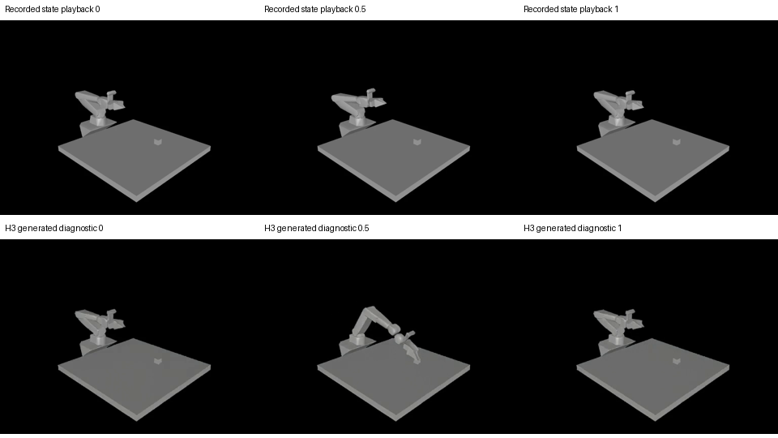

# Codex / ASPIRE 特权状态固定场景实测

日期：2026-11-14（Asia/Shanghai）。对应 PR #2，基线为 `translate-view`。本目录保存本轮实验代码和汇总，属于任务产物，不是新任务的固定注册表。完整私有运行记录保留在本机 `runs/server-cap-state-20261114-01` 和服务器本轮独立目录。

## 已执行的链路

使用已有 AIRBOT 单臂 + G2 资产，手工创建桌面和参考方块，固定 Isaac Lab 3.0 / Newton + MJWarp。没有调用资产检索、场景生成或自动组装管线，没有恢复后端选择探针。

本轮目标是**非接触关节控制**：根据实际复位关节位置，先同时达到 J1 +0.12 rad、J2 +0.08 rad 的路点，再返回实际初始位姿。没有抓取、提盘、移动方块或抽屉操作。Judge 在模型运行前固定：轨迹路点误差 <0.025 rad、最终归位误差 <0.03 rad，且无程序执行错误。这些是本实验约束，不是厂家精度声明。

本机运行 Codex CLI 0.141.0，经用户指定的 FYP Tailscale 网关调用 `gpt-6.1-sol`；使用已有 ASPIRE 受限 AST 解释器在服务器执行控制程序。模型只得到公开 API 和实测特权状态；没有图像感知、文件/仿真器直接访问、reset 或 Judge 修改权限。个人 token 仅留在本机父进程内存，服务器没有模型密钥。

## 控制与迭代结果

- 一个提供的诊断初始程序，只命令 J1 到绝对零位，开发/验证两次均被真实 Judge 拒绝。这不是模型首版失败。
- 两个模型 Actor 候选均在开发种子通过，并各自在选择验证种子通过。
- 选择后冻结的程序在一个独立留出种子通过；这是一次冷启动、一个留出种子，不足以估计广泛分布上的 ≥80% 成功率。
- Distiller 首次把 `requires` 填成自然语言前提，被接口拒绝。原请求和费用计数保留；修复为 API 名称枚举 schema 后，从冻结程序续接，未重做搜索和已有物理回合。
- 新会话 Verifier 仅接收任务与技能，独立生成程序，在另一复位种子通过，并明确按原样应用技能。技能已入库。
- 搜索共 5 次实际 FYP 模型请求：2 次 Actor、2 次 Distiller（含失败格式）、1 次 Verifier。独立 provider 接通检查的 1 次请求另计。美元成本未知，未记为零。
- 全部 9 个物理回合共 7,050 控制步；包含两次诊断初始程序失败，不删除失败分母。其余 7 次通过是相关的开发、验证、技能复验、留出和重复执行，不能解释为 7 次独立冷启动。
- 独立进程从原始状态重算路点/归位、有限值、N 个动作对应 N+1 个状态；全部声明结果吻合。

冻结程序、技能提案、匿名化会话摘要及机器可读汇总分别见本目录 `frozen-program.json`、`skill-proposal.json`、`provider-receipts.json`、`summary.json`。真实会话 ID 仅保留在本机运行证据中。

## 轨迹、HDF5 与视频

- 留出回合记录 1,051 个状态与 1,050 个动作，已导出诊断 HDF5 和 640×480、24 fps、211 帧的状态回放视频。
- 同种子、冻结程序在独立复位后重新执行，工具连杆位置最大差异为 0 m。此项是程序重复执行检查；不等同于独立的底层 applied-action 流重放验收。
- 回放画面来自 Newton 导出场景及记录状态，经 MuJoCo 离屏渲染；控制与动力学仍是 Newton/MJWarp，没有切换仿真后端。
- H3 使用真实回放首末帧生成 512×384、24 fps、124 帧、约 5.17 秒的独立诊断视频；实际推理约 147.7 秒，采样显存峰值 31,843 MiB。
- 已检查首、中、末帧。H3 保留了主要场景布局，但明显放大机械臂运动，**未通过轨迹忠实度准入**。它与真实状态回放分别命名，不能作为动作标签、物理成功、摄影真实性或训练数据证明。

没有签发训练或 real-ready 数据准入证书。H3 完成后在队列为空时请求释放模型显存，保留原服务待命。

## 软件回归与修复

初次完整 Linux 回归：767 通过、13 失败、7 跳过，109 个 subtest 通过。失败原因定位为：

1. 原基线中文 brief 已变更，测试仍检查英文短语；保留同一数值预算，更新文案断言。
2. Windows 工作副本/源码打包产物中的 `.sh` / vendored patch 含 CRLF，Linux 解析与摘要检查失败；部署文件改为 LF，并增加 `.gitattributes` 使未来归档保留规范字节。原 patch 的 LF 摘要与既有固定值一致。
3. 基线翻译改写了要求原样保留的 LoRA fuser 文档字符串；恢复 `main` 中原始源码的 LF 字节，SHA-256 回到既有测试固定值，没有修改期望摘要。
4. 服务器系统 FFmpeg 不支持 `fps_mode`；在本轮独立环境安装 registry 分发的 imageio-ffmpeg，通过本轮专用 PATH 使用，不覆盖系统二进制。

这些修复未修改机器人资产、任务 Judge 或成功门槛。最终完整 Linux 回归：**781 通过、7 跳过、109 个 subtest 通过**，耗时 632.57 秒；两条依赖插件弃用警告。lint 11 条规则无违规，指令审计无错误。见 `pytest-final.txt`、`lint-final.txt`、`audit-final.txt`；首次失败报告保留在 `pytest-initial.txt`。本机新增/相关协议检查也覆盖格式错误、缓存篡改、超时不重发、Verifier 隔离、同代不可见成绩和 FYP 个人 token 不进入子进程。

下图上排是真实记录回放，下排是 H3 诊断生成；列为各自的起始、中间和结束位置。H3 中间帧明显改变了动作幅度，未作为轨迹一致性通过证据。

## 尚未完成或不在本轮范围

完整抓放、TCP IK/规划、接触判定、20 条生产轨迹、通用场景编译、严格 applied-action 重放、H3 全时序条件控制和训练准入尚未验收。邮箱连接器返回 403，QQ 邮箱网页等待用户手动登录；视频邮件在确认送达前均标为未发送。
